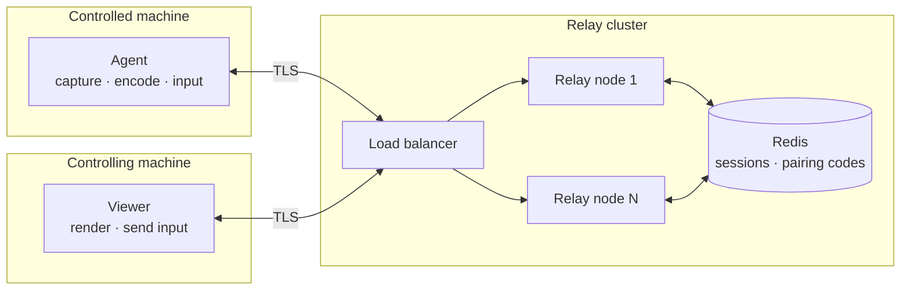

# MRemora

Cross-platform remote desktop for Windows and Linux, written in modern Java.

MRemora lets you see and control a Windows or Linux computer from another machine in real time. An agent runs on the controlled computer, captures the screen and injects mouse and keyboard input, while a relay server connects both sides, even behind NAT.

> 🚧 Work in progress. This document describes the target architecture.

## Architecture



| Component | Responsibility |
|---|---|
| **Agent** | Captures the screen, detects changed regions, encodes frames, injects mouse and keyboard input |
| **Relay** | Authenticates clients, pairs sessions, forwards traffic without decoding it |
| **Viewer** | Renders frames, sends input, shows connection stats |
| **Protocol** | Shared binary message format and codecs |

### Connection flow

1. The agent connects over TLS and receives a short-lived, single-use pairing code.
2. The viewer connects with that code and the relay links both sessions.
3. The agent streams screen updates; the viewer sends input back.
4. The person at the controlled machine sees an active-session indicator and can end it at any time.

## Architectural assumptions

### Platforms
- **Windows 10+** and **Linux on X11** first.
- **Linux on Wayland** in a later stage, through XDG Desktop Portals and PipeWire, with the user approving access in a system dialog.
- Platform code sits behind small interfaces (`ScreenCapturer`, `InputInjector`), selected at runtime.
- Screen geometry includes **DPI scaling and monitor layout**, so input coordinates always match what the viewer sees.

### Performance
- **Send only what changed:** the screen is split into tiles; only changed tiles are encoded.
- **Input before video:** mouse and keyboard events never wait behind frame data.
- **Drop, don't buffer:** if the viewer falls behind, old frames are discarded so latency and memory stay bounded.
- **Off-heap buffer pools** for frame data, benchmarked with JMH, to keep GC pauses out of the hot path.
- Native capture through the **Foreign Function & Memory API** (Desktop Duplication on Windows, XShm or PipeWire on Linux), without JNI.
- Targets: 30 FPS at 1080p for office work, under 50 ms p95 latency on a LAN, under 1 Mbit/s for a mostly static screen.

### Input
- **Physical keys** are sent as USB HID codes, which works for shortcuts and games regardless of OS.
- **Text** is sent as Unicode, so keyboard layouts and characters like `ą`, `ę`, `ż` arrive correctly.

### Scalability and reliability
- Relay nodes are **stateless** apart from open connections; sessions and pairing codes live in Redis with a TTL.
- Relays scale horizontally behind a load balancer (Kubernetes HPA).
- Netty event loops for I/O, virtual threads for blocking work.
- Heartbeats detect dead connections; agents reconnect with exponential backoff.
- Protocol version is negotiated in the first message, so older and newer clients can still talk.

### Security
- **TLS 1.3** on every connection.
- Pairing codes expire after a few minutes, work once, and are invalidated after repeated failed attempts.
- Clipboard sharing is **off by default**, text only, with a size limit.
- The relay never decodes or stores screen content. End-to-end encryption between agent and viewer is planned.

### Privacy and consent
MRemora is meant for controlling your own machines or helping someone **with their explicit consent**. A session always shows a visible indicator on the controlled machine and can be ended there at any time.

### Out of scope (for now)
- Controlling elevated (administrator) windows, UAC prompts and the Windows login screen; these require running the agent as a system service.
- File transfer, audio, macOS.
- Direct peer-to-peer connections.

## Modules

```
mremora/
├── mremora-protocol/   # messages, codecs, framing
├── mremora-agent/      # capture, encoding, input injection
├── mremora-relay/      # Netty server, pairing, routing, metrics
├── mremora-viewer/     # JavaFX client
└── mremora-testkit/    # fakes, fixtures, load generator
```

## Build

Requires JDK 25 or newer. Maven is provided by the wrapper.

```bash
./mvnw verify        # Linux
mvnw.cmd verify      # Windows
```

## Tech stack

Java 25 · Netty · Foreign Function & Memory API · JavaFX · Redis · Micrometer · Prometheus · JUnit 6 · JMH · Testcontainers · Docker · Kubernetes · GitHub Actions

## Roadmap

- [ ] **Stage 1:** LAN connection, full frames, mouse control (Windows, Linux X11)
- [ ] **Stage 2:** tile-based deltas, compression, flow control, stats overlay
- [ ] **Stage 3:** relay, TLS, pairing codes, Redis
- [ ] **Stage 4:** keyboard (HID + Unicode text), clipboard
- [ ] **Stage 5:** native capture via FFM, hardware or royalty-free video codec
- [ ] **Stage 6:** Wayland support
- [ ] **Stage 7:** multi-node relays on Kubernetes, load tests

## License

MIT © 2026 MTech Solutions Mariusz Śmistek
